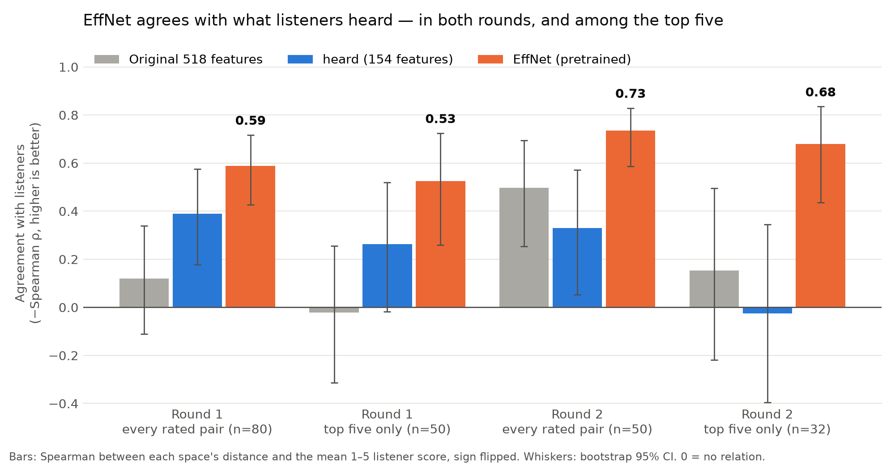
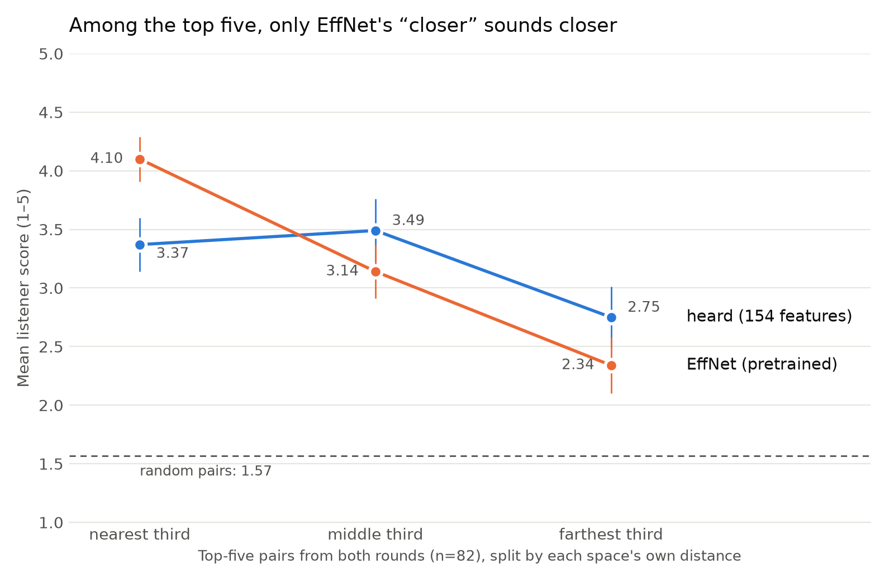

# Why the app moved from `heard` to EffNet

Rebuild everything here with `uv run python -m modeling.effnet_vs_heard`.

## 1. Agreement with listeners

Spearman between each space's distance and the mean 1–5 listener score, sign
flipped so **higher is better**; 0 means no relation. 95% CI from 4,000
bootstrap resamples (`agreement.csv`).

| | Original 518 | `heard` 154 | **EffNet** |
|---|---:|---:|---:|
| Round 1, every rated pair (80) | 0.12 | 0.39 | **0.59** |
| Round 1, top five only (50) | −0.02 | 0.26 | **0.53** |
| Round 2, every rated pair (50) | 0.50 | 0.33 | **0.73** |
| Round 2, top five only (32) | 0.15 | −0.03 | **0.68** |

## 2. Does "closer" sound closer, among the top five?

All 82 top-five pairs from both rounds, split into equal thirds by each space's
own distance (`thirds.csv`). Random pairs average 1.57.

| | nearest third | middle third | farthest third |
|---|---:|---:|---:|
| `heard` | 3.37 | 3.49 | 2.75 |
| **EffNet** | **4.10** | 3.14 | 2.34 |

EffNet's score falls step by step as its distance grows. `heard`'s nearest third
scores no higher than its middle third — inside its own top five, its ordering
carries no information a listener can hear.

## 3. The practical reasons

| | `heard` | EffNet |
|---|---|---|
| Tracks covered | 8,000 (fma_small) — rhythm and HPSS features were only built for these | 24,757 (fma_medium) |
| Cost of a new track | rhythm extraction + HPSS (~20 min for 8,000) | one pass of a pretrained encoder |
| Validated by ear? | round-one gain did not replicate in round two | agrees with listeners in both rounds |

## What this does and does not show

- **Tested:** EffNet's sense of distance, on 130 pairs people rated.
- **Not tested:** EffNet's own recommendations. Every rated pair was chosen by
  `all` or `heard`; nobody has yet listened to what EffNet picks, nor to the
  fma_medium tiers the app ships.
- **Retrospective:** run after the ratings were in, not pre-registered. Each
  pair carries 1.4–1.6 ratings on average, so single pairs are noisy; the
  pattern across rounds is the evidence.
- The pairs were picked by `all` and `heard`, which narrows their distance
  range inside the top five; the "every rated pair" rows are the fairest
  comparison, and EffNet leads there too.
