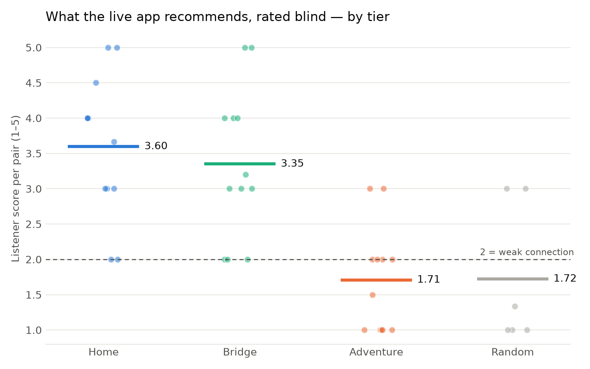

# Round four — results

42 pairs rated, 76 ratings.

## Q1 — does each tier beat random?

| tier | pairs | mean | random mean | p (Holm) | beats random | p vs 1.57 (secondary) |
|---|---:|---:|---:|---:|---|---:|
| Home | 12 | 3.60 | 1.72 | 0.0100 | yes | 0.0002 |
| Bridge | 12 | 3.35 | 1.72 | 0.0116 | yes | 0.0002 |
| Adventure | 12 | 1.71 | 1.72 | 0.4605 | not shown | 0.5591 |

## Q2 — Home ≥ Bridge ≥ Adventure?

Spearman ρ = -0.627, one-sided p = 0.0000 → the dial is heard as a dial.

## Q3 — is Adventure still related?

**not shown to be related**

## Per seed (mean score)

| seed | Home | Bridge | Adventure | Random |
|---|---:|---:|---:|---:|
| Ash On Dust | 3.00 | 4.50 | 1.50 | 3.00 |
| Humble Tripe | 3.75 | 2.60 | 1.75 | 1.00 |
| Milton Arias | 2.50 | 2.50 | 2.00 | 1.00 |
| Out Of Orion (Ox3) | 3.83 | 3.50 | 2.50 | 1.33 |
| The Defibulators | 3.50 | 2.50 | 1.50 | 1.00 |
| The Four Harmony Kings | 5.00 | 4.50 | 1.00 | 3.00 |

